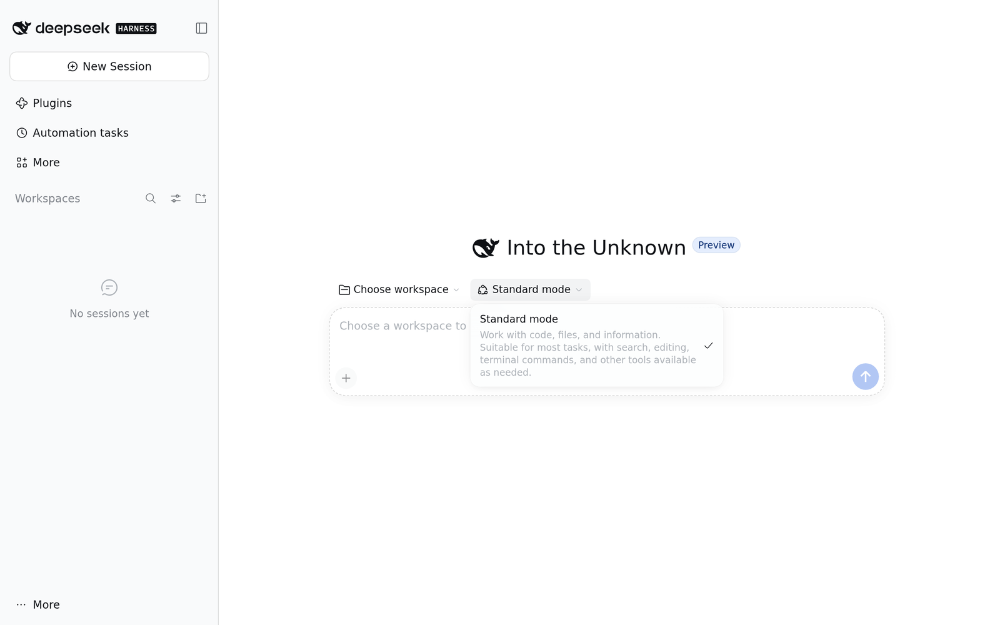
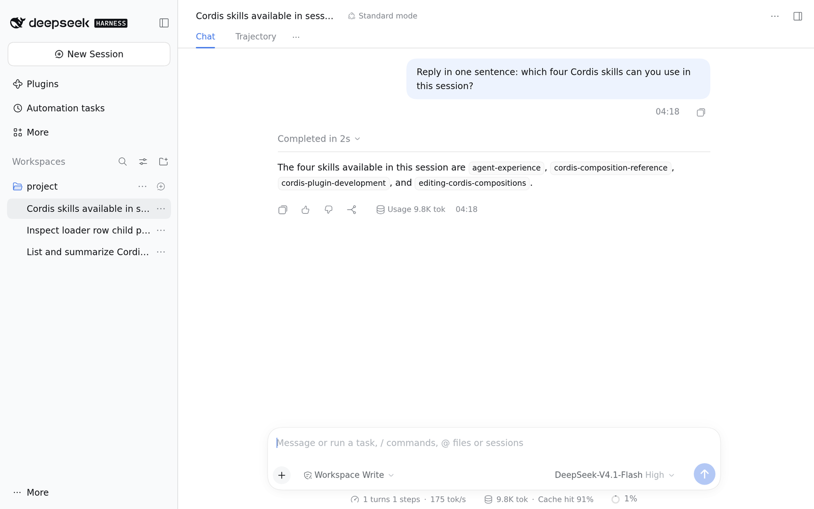
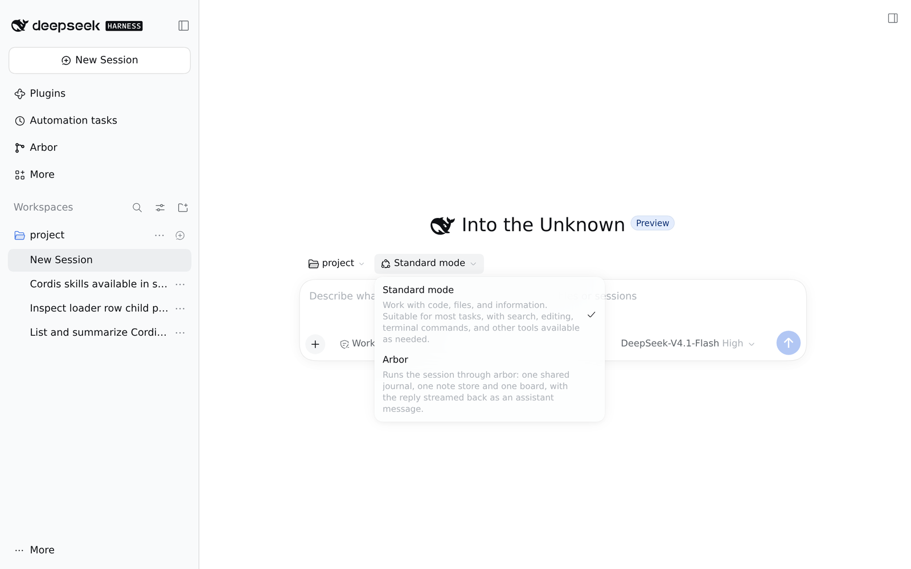

# dsh-standard-plus

Replace [DeepSeek Harness](https://github.com/deepseek-ai/deepseek-harness)
(DSH)'s four shipped Web agent modes with one **Standard mode** that also
carries Creator mode's Cordis tools. It is a separately installable bundle and
works with or without [dsh-arbor](https://github.com/4fuu/dsh-arbor) installed.

> **Status.** This is a patch-layer bundle pinned to one DSH version, built
> against DSH internals rather than a stable public API. Read
> [Versions and compatibility](docs/versions.md) before installing it on
> anything you care about. The package is prepared at `2026.1110.0`; it is not
> a DSH release.

## Install

Requirements: Node.js 24.9 or newer and DeepSeek Harness `dsh-v0.2.2-rc.1`.

```bash
dsh plugin --profile web add @4fu/dsh-standard-plus@2026.1110.0
```

Restart DSH. The mode picker now offers one **Standard mode**, and a session
created under it has the Cordis tools and skills. The bundle is a patch layer:
the profile installs no JavaScript and no second copy of a `@deepseek-ai/dsh-*`
or Cordis package.

## What it changes

DSH's Web bundle declares four agent presets: `standard`, `ptc`, `minimal` and
`cordis` (Creator mode). This bundle's patch:

- disables those four preset rows;
- inserts one `@deepseek-ai/dsh-agent-preset` declaration whose `config.id` is
  still `standard`, so a session recorded under Standard keeps resolving;
- keeps Standard's plugin list and adds the three things Creator mode has and
  Standard lacks:
  - `tool-cordis`, which registers `cordis_inspect_list` and
    `cordis_inspect_query`;
  - `tool-plugin-market` under Creator mode's profile condition, so
    `plugin_manager` is available in a profile;
  - `skill-filesystem` with Creator mode's `customSkillDirs`, which mounts
    `agent-experience`, `cordis-composition-reference`,
    `cordis-plugin-development` and `editing-cordis-compositions`.

The plugin list is generated from the pinned DSH's own `preset-standard` and
`preset-cordis` files by `scripts/generate-patch.mjs`; `pnpm check` fails if the
committed patch differs from what the installed DSH produces. `!!js` platform
conditions are preserved as DSH writes them.

The declaration publishes no name or description. DSH resolves a shipped
preset's display copy from its own locale dictionaries only while the
declaration has no name, so the mode is presented as **Standard mode**,
**标准模式**, **標準モード** and so on in the user's DSH language, with DSH's
Standard description. The extra tools are not claimed in the picker copy.

Every other row is left alone. In particular, `@4fu/dsh-arbor-bundle`'s `arbor`
preset stays selectable beside the new Standard mode.

## Screenshots

| Mode picker | A session in the new Standard mode |
| --- | --- |
|  |  |

With dsh-arbor installed, the same picker shows Arbor beside Standard:



## Old sessions and the mode settings

Sessions recorded as `standard` keep working and resume under the new
declaration. Sessions recorded as `ptc`, `minimal` or `cordis` that have already
started a turn cannot resume while the bundle is installed, because those
presets are no longer declared; a still-blank session is reused as Standard. The
transcript stays readable, and removing the bundle restores the presets and
their sessions. The mode settings page lists the remaining modes, so the
Creator-mode entry is gone while the bundle is installed. A saved default from
one of the removed modes leaves host-created sessions without a preset; set the
default to Standard before installing.

These are deliberate consequences of replacing the shipped modes rather than
hiding them. The exact behavior, the failure text, and why hidden-but-resolvable
was not chosen are in [Modes, old sessions and uninstall](docs/modes.md).

## Undo

```bash
dsh plugin --profile web remove @4fu/dsh-standard-plus
```

Restart DSH. The four shipped modes return, and sessions recorded under
`standard` resolve to DSH's own Standard definition again (they lose the Cordis
tools). Removing the bundle does not change a saved default preset; set it back
if you want another mode.

## DSH pin

DSH is pinned to **`dsh-v0.2.2-rc.1`** (npm `@deepseek-ai/dsh@0.2.2-rc.1`). The
package's `engines.dsh` is that exact version, and the patch is generated from
that version's own preset files. A different DSH version is unsupported; DSH
skips a bundle whose `engines.dsh` does not match unless the profile records a
version exemption. The pin, the upgrade procedure and every check are in
[Versions and compatibility](docs/versions.md).

## Development

```bash
pnpm install --frozen-lockfile   # or .agents/setup in a fresh orb
pnpm check                       # pin, generated patch, contract tests
pnpm check:profile               # packed tarball into a fresh DSH web profile
pnpm generate                    # rewrite the patch from the installed DSH
pnpm pack                        # inspect the published tarball
```

`pnpm check:profile` installs DSH from npm into a temporary directory, so it
needs network access the first time it runs. It verifies a new Standard session,
the exact model-facing tool list and skill catalog, a pre-install Standard
session resuming, a started session in each removed mode failing and then
resuming after removal, the Arbor preset beside Standard, and the uninstall
path. Set `STANDARD_PLUS_CHECK_WORK` to keep its work directory, or
`STANDARD_PLUS_CHECK_ARBOR=0` to skip the Arbor phase.

## Layout

```text
packages/dsh-standard-plus/
  cordis.patch.yml  generated bundle patch
  package.json      the installable bundle at the pinned DSH version
scripts/
  generate-patch.mjs  builds the patch from the pinned DSH's preset files
  check-dsh-pin.mjs   engines.dsh, exact versions, no DSH dependency
  check-profile.mjs   the packed install against a fresh DSH web profile
  publish.mjs         pack or publish the bundle
test/
  patch.test.ts       the installed contract: one mode, Creator tools, no name
docs/
  modes.md            old sessions, settings and uninstall
  versions.md         the DSH pin and the checks
```

## License

MIT. See [LICENSE](LICENSE).
