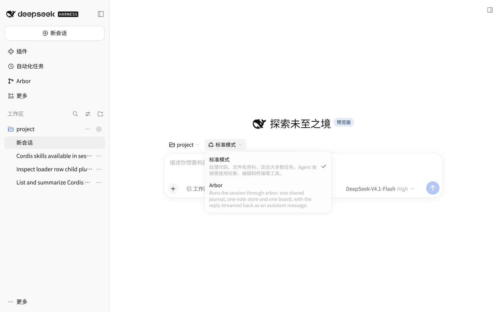
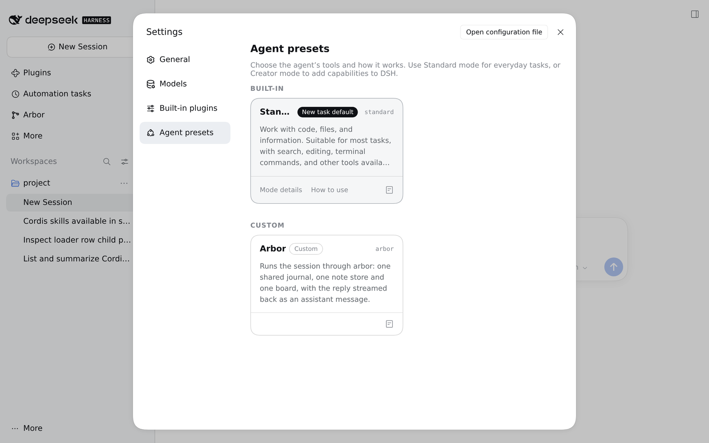

# Modes, old sessions and uninstall

This page records what replacing DSH's shipped agent modes does to the modes, to
sessions created before the install, to the mode settings, and to the profile
when the bundle is removed. It is written for DSH `0.2.2-rc.1`, the only version
this bundle supports. The observations come from a fresh web profile with the
packed tarball installed through `dsh plugin --profile web add`; the same checks
run in `pnpm check:profile`.

## One declaration, four disabled rows

DSH's Web bundle declares four presets in `@deepseek-ai/dsh-web-app`:
`preset-standard` (`config.id: standard`), `preset-ptc`, `preset-minimal` and
`preset-cordis` (Creator mode). A preset row is a loader row; sessions record
the **`config.id`**, not the loader row id.

The bundle patch does two things:

1. It disables `preset-standard`, `preset-ptc`, `preset-minimal` and
   `preset-cordis` by row id.
2. It inserts one more `@deepseek-ai/dsh-agent-preset` row, with loader id
   `preset-standard-plus` and `config.id: standard`.

The loader row id must differ from every existing row id, while `config.id`
must stay `standard` so a session recorded under Standard resolves to the new
definition. `order: 1` keeps Standard first in a roster that also has a preset
with a higher order, such as Arbor's `50`.

The four disabled rows stay in the composed tree, disabled. They are not
renamed, so a profile or another bundle can still address them by id, and the
one remaining declaration is the only mode DSH's roster, picker and settings
page present.

`agent-preset-registry`'s `config.default` stays the shipped `standard`. The
bundle does not patch the registry and does not write the user's
`selectedDefault` setting.

## The plugin list

`packages/dsh-standard-plus/cordis.patch.yml` is generated, not hand-maintained.
`scripts/generate-patch.mjs` reads the pinned
`@deepseek-ai/dsh-web-app/presets/standard.patch.yml` and
`presets/cordis.patch.yml`, then:

- keeps Standard's plugin list, including its persona, filesystem, shell, jobs,
  schedule, goal, plan-mode, compaction, delegation, subagent, todo, web and
  presentation rows;
- replaces Standard's `skill-filesystem` row with Creator mode's, which adds
  `customSkillDirs`;
- replaces Standard's `tool-plugin-market` row (shipped `disabled: true`) with
  Creator mode's row, whose `disabled` is
  `!!js "!ctx.get('profileContext')"`;
- adds Creator mode's `tool-cordis` row after `tool-web`.

Every `!!js` expression is moved as an expression, not evaluated at build time.
The `customSkillDirs` expression is DSH's own:

```text
process.getBuiltinModule('node:path').join(
  process.getBuiltinModule('node:path').dirname(
    process.getBuiltinModule('node:module').createRequire(baseUrl).resolve('@deepseek-ai/dsh-agent-preset/package.json')
  ),
  'skills'
)
```

`baseUrl` is the profile root. In an installed profile DSH resolves
`@deepseek-ai/dsh-agent-preset` from the installation, so the expression finds
the four skills; the profile check asserts the session skill catalog contains
exactly `agent-experience`, `cordis-composition-reference`,
`cordis-plugin-development` and `editing-cordis-compositions`. The model-facing
tool list contains `cordis_inspect_list`, `cordis_inspect_query` and
`plugin_manager` beside Standard's tools.

## Display copy

A shipped preset's name and description are not stored in the preset. DSH's
client resolves them from its locale dictionaries through
`@deepseek-ai/dsh-agent-preset-registry/display`, but only while the declaration
publishes no `name`. Therefore the new declaration leaves `name` and
`description` unset, keeps `config.id: standard`, and inherits DSH's localized
**Standard mode** / **标准模式** / **標準モード** copy in every locale DSH ships.
Publishing a custom name would replace that localized copy with one unlocalized
string and is deliberately not done.

With DSH's UI in Chinese, the same declaration is **标准模式** with the shipped
Chinese description. Arbor's own description stays English in the same menu
because a custom declaration owns its untranslated copy:



## Sessions created before the install

| Recorded preset | What happens with the bundle installed |
| --- | --- |
| `standard` | Resolves to the new declaration. The session keeps its id and log and resumes with Standard's tools plus the Cordis tools and skills. Verified with a session created and started before the tarball was installed. |
| `ptc`, `minimal`, `cordis`, already started | No declaration supplies the id. A prompt or any other resume path fails with `gateway/internal: resume failed for session "<id>": RemoteError: Unknown agent preset: <id>`. The transcript remains readable. `skills/list` answers with an empty catalog for the session. |
| `ptc`, `minimal`, `cordis`, still blank | `session/create` with the session id and its cwd reuses the blank session, logs an `agent-preset/selected` change to `standard`, and returns the same id with `agentPreset: standard`. Calling `session/create` on a session that has started a turn creates a new session instead; the old one is untouched. |

Removing the bundle restores the three declarations, and their started sessions
resume again. `pnpm check:profile` automates the whole sequence: it starts one
session in each removed mode before the install, asserts the `Unknown agent
preset` failure while the bundle is installed, and asserts each session accepts
a prompt again after the removal.

### Why the old modes are disabled rather than hidden

DSH's preset registry has no hidden flag. `agentPresets.list()` returns every
registered definition, the picker renders every healthy row, and the settings
section renders the full roster. A definition that fails to mount is marked
`broken`: the picker hides it, but `retain()` refuses to bind it, so a session
would still not resume.

The remaining option would be a browser client plugin that filters the roster
before its surfaces render it. That would keep the three retired compositions
mounted in the registry, expose them to every surface that does not load that
client plugin (the CLI, the SDK, headless and ACP), and pin a second DSH
internal surface for a compatibility path the bundle cannot own. The bundle
therefore removes the modes. The cost is explicit: a started session in PTC,
Minimal or Creator mode cannot continue until the bundle is removed. A user who
needs those sessions should finish or export them before installing, or keep the
bundle off that profile.

## The mode settings page

The General settings section reads the same roster. With the bundle installed it
lists **Standard** only (and **Arbor** when `@4fu/dsh-arbor-bundle` is also
installed). The Creator-mode entry is gone because no definition declares
`cordis`; there is no separate switch that could keep it visible. DSH's
section-introduction copy is a static client string, not roster data, so it
still says "Use Standard mode for everyday tasks, or Creator mode to add
capabilities to DSH" even though no Creator-mode entry exists. The bundle does
not shadow a DSH client string; removing the entry is the whole change.



A saved default preset is a settings value (`agent-preset-registry`'s
`selectedDefault`), not part of the bundle. If it named `ptc`, `minimal` or
`cordis` before the install, it keeps naming it after the install. A host
`session/create` that names no preset then fails with
`agent-preset/not-found` (`Unknown agent preset: <id>`) until the default is
changed. The web composer falls back to the first healthy row, so a session
started from the New session button can still be created, but other clients use
the host default. Set the default to Standard before installing, or change it
in the mode settings afterwards. The bundle does not write this setting, and
removing the bundle does not change it either.

## Uninstall

```bash
dsh plugin --profile web remove @4fu/dsh-standard-plus
```

Restart DSH. The profile's `dsh.profile.bundles` no longer lists the bundle and
the shipped Web layer declares its four presets again, so the roster returns to
`standard`, `ptc`, `minimal`, `cordis` in that order. The old sessions from
those modes resolve and resume, and a session created under the bundle's
Standard mode resolves to DSH's own Standard definition: the same id and log,
without the Cordis tools and the four skills. The profile check asserts the
former bundle session sees no Cordis skills after the removal.

If `@4fu/dsh-arbor-bundle` is installed, removing this bundle leaves it and its
`arbor` preset in place.

## Profiles with their own preset edits

DSH's preset editor saves an override for a row id in the profile's
`cordis.patch.yml`, usually as a `config.plugins` override for
`preset-standard`. The bundle disables the shipped `preset-standard` row, so an
existing override no longer feeds the mode a user picks; the new row is
`preset-standard-plus`, and that is the row to override after installing. Do not
re-enable a shipped preset row (a patch with `disabled: false`): it would declare
its `config.id` a second time, and DSH rejects a duplicate preset id.

The bundle never edits the profile's `cordis.patch.yml`, its `package.json`, or
its settings document. Install and remove only change the package dependency and
the composed-bundle list that `dsh plugin` owns.

## Mixed install with dsh-arbor

`@4fu/dsh-arbor-bundle@2026.1110.1` disables the base `agent` row and inserts
`arbor-preset` with `config.id: arbor`; it does not touch the four preset rows
this bundle owns. The roster with both installed is `standard`, then `arbor`.
Bundle order does not matter because the patches target different row ids, and
the `order` fields decide the picker order. The profile check installs both,
asserts the roster, and removes Arbor again.
